# BadmintonAce revitalized

This is the revitalization repository by Eike Dohmen of the CAD, Code and Documentation for Badminton ACE.

It is based on the repository created by Peter Sinclair for his Hackaday Prize 2023 Entry

[Hackaday Prize 2023 entry](https://hackaday.io/project/190336-badminton-ace-shuttle-launcher)

## Project scope

Badminton Ace is a project to create a relatively low cost multi-axis robot capable of launching badminton shuttles in user defined patterns for teaching and training. This project seeks to engage children and adults in the exciting sport of badminton to improve physical health while providing an engaging mechatronics system that demonstrates the power of STEM.

Users or trainers can connect to the launcher using wifi then select and adjust shot placement and pattern to learn or practice new badminton return techniques. This will be done directly in the browser using an interactive 3D court with controls for rotation and trajectory.
For kids to use Badminton ACE on their own and get them away from SmartPhones a touch TFT was added, enabling to load different presets.

## Education

The robot can also be used as a powerful STEM educational tool throughout the build process if desired. With multiple sensors, 2 brushless and 4 servo motors, 3D printing, laser cutting, urethane molding, programing, inverse kinematics, and more, this project covers a wide range of topics for those looking to learn how it all works. It also helps to encourage excercise for it's users.

## Revitalization

I wanted to `revitalize` the projects started by `Peter Sinclair` and performed many tiny adjustments especially in the CAD files, to improve assembly and operation. Additionally I wanted to fill some gaps regarding electronics and assembly documentation to make it easier to build your own BadmintonACE.

## Alternate concept (temporary)

An alternate grip+pull concept for gripping the next shuttle with a moving gripper servo mounted to a linear slider carriage was implemented. This is just a (temporary) enhancement to investigate if it outperforms the existing grip+push concept, though staying fully compatible with the original concept. For the grip+pull concept the internal diameter of the tube base is reduced with an insert to prevent the next shuttle from directly falling into the machine.

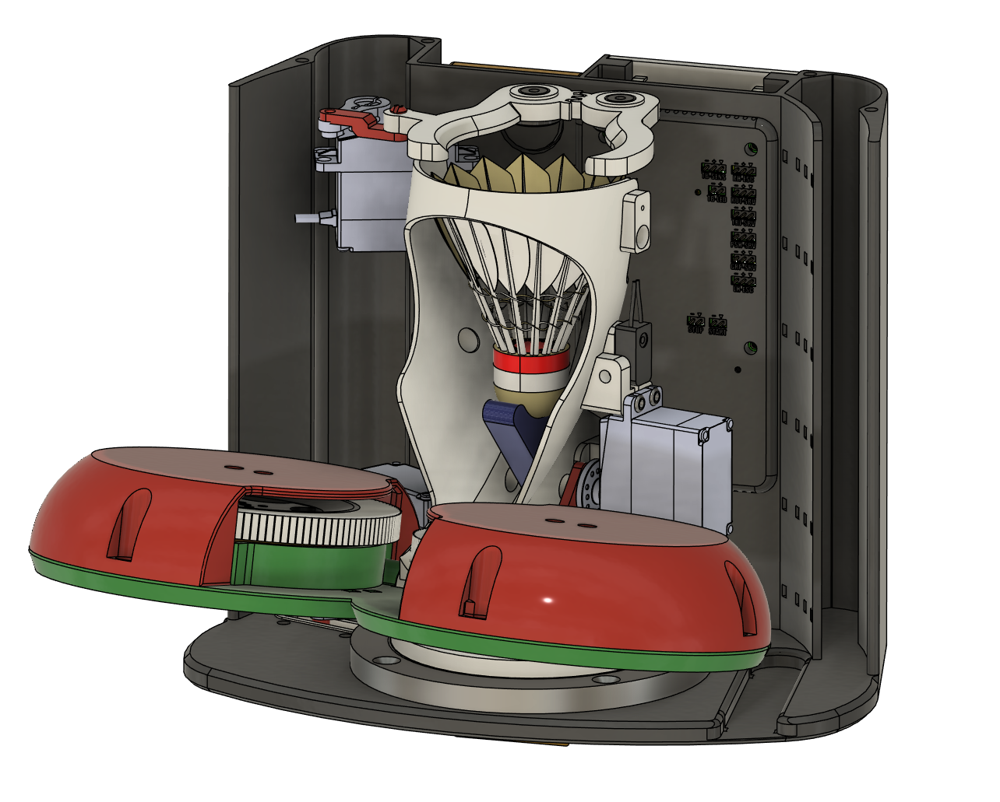
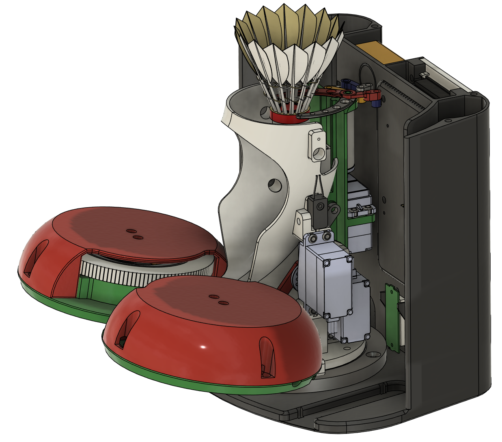

## Touch TFT

A 4.0" TFT Module with 480x320 px and an SPI interface (using a `ST7796` integrated circuit) was added to the design. The touch functionality for the displays used is realized by a `XPT2046` integrated circuit. Please take care for matching or compatible driver ICs as there are many versions of these displays offered, but not all of them are performing well or are compatible with the utilized `TFT_eSPI` library.

[TFT_eSPI library documentation](https://github.com/Bodmer/TFT_eSPI/blob/master/README.md)

The pins used on the ESP32 are:

* Data to TFT - TFT_MISO (GPIO19)
* Data from TFT - TFT_MOSI (GPIO23)
* Clock for TFT - TFT_SCLK (GPIO18)
* Chip select for TFT - TFT_CS (GPIO5)
* Data or command selection for TFT (high: command, low: data) - TFT_DC (GPIO26)
* Reset pin for TFT - TFT_RST (GPIO4)
* Backlight for TFT - TFT_BL (GPIO0)
* Chip select for touch - TOUCH_CS (GPIO15)

The Touch TFT used for design was bought here:

[4.0-inch TFT touchscreen display](https://www.roboter-bausatz.de/p/4-tft-touchscreen-display-modul-st7796-480x320)

Specifications of the Touch TFT can be found here:

[LCD Wiki product documentation](https://www.lcdwiki.com/4.0inch_SPI_Module_ST7796#Product_Documentation)

## Status LED

In order to better see what the machine does when standing opposite to it on the court - a status LED has been implemented utilizing a flexible `WS2812B` LED stripe which is placed inside the Tube Base part.
Currently all LEDs show the same color and brightness - though, WS2812 LEDs may be controlled individually. Set `statusLedPin` (default is GPIO13) and `statusLedCount` to match the number of LEDs of the connected strip. The strip gets powered with internal 5 V supplied by the Electronic Speed Controllers (ESCs) and is controlled via the powerful `FastLED` library.

[FastLED library](https://github.com/FastLED/FastLED)

The status LED indication follows machine and obstruction state:

* blue means the ultrasonic sensor reports a persistent obstruction,
* red for two seconds after an obstruction clears or the launcher stops,
* red-to-green pulses for countdown before a run,
* green means running,
* dimmed red breathing is the idle state.

Obstruction indication has priority over all other states. Idle breathing is capped between brightness values 4 and 28 (on a 0–255 scale), with an overall LED brightness cap of 64.

## Printed circuit board (PCB)

It is possible to realize a fully functional ACE with an arbitrary ESP32 board and without using the specialized PCB. Though, as a lot of people are feeling overwhelmed by electronics and microcontrollers but would love to realize such a machine for their kids or their club, I wanted to supply a plug-and-play PCB, which has proper annotations and by that should reduce the propablity to destroy components, reduce potential frustration and increase fun.
The power supply is fully realized by the two electronic speed controllers utilizing their Battery Eliminator Circuit `BEC` capability delivering each 3 A at 5 V.

I splitted the circuits on the PCB to avoid interferences of the controllers, so the right ESC supplies

* gripper servo,
* pusher servo (or carriage servo),
* trajectory servo and
* rotation servo

while the left ESC supplies:

* ESP32 microprocessor,
* TFT,
* start and stop buttons,
* ultrasonic sensor,
* through beam sensor and
* status LED.

You can find the most recent gerber files (also as packaged zip file) in the PCB subfolder.

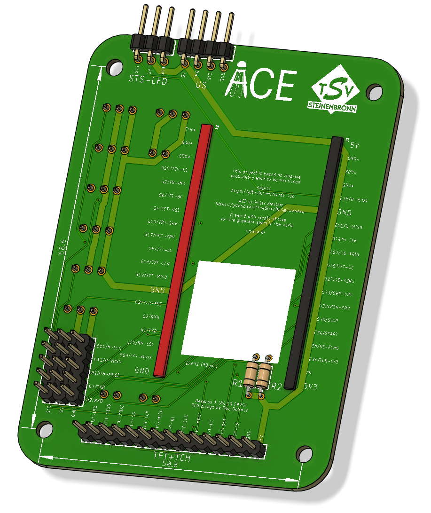
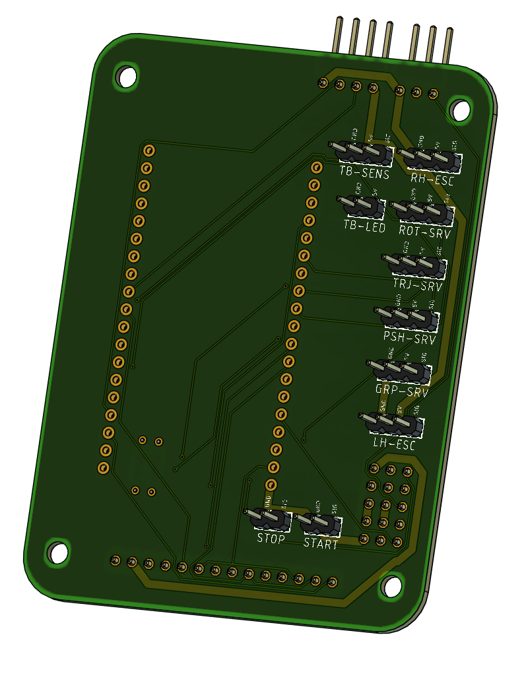

## Shooting wheels

The most challenging part of the machine in regards of interrelation of design, material specification and performance are the shooting wheels. The wheels necessitate to components: the inner rim which needs to withstand high mechanical stresses resulting from rotational speeds of up to 5000 rpm (in theory up to 8000 rpm) and on the other hand we need a flexible tyre with high surface friction in order to ensure "gripping" of each shuttle, squeeze prevention of the cork of each shuttle and maximum energy transfer by following the shuttle heads shape during acceleration of it.
If the tyre is too "stiff" the mechanical stresses within our ACE motor mount and the motor's bearings will be high, but the shuttles will hardly fly 2 m as most of the energy is transfered to our design but not to the shuttle.
So, ideally - referring to Baddy findings - the stiffness of the "rubber" tyre should be around `45 Shore A` hardness. To realize this flexibility while making the tyre withstand thousands of shots in terms of wear resistance, polyurethane is the material to choose.
Peter and the Baddy community use moulded tyres, which needs a mould, preferably a degassing unit and something to balance the final wheel assembly.
I wanted to use a different approach to make things more reproducible and easier: 3D printing of the wheels as a two component assemply print, utilizing PETG for the rim and `soft` TPU for the tyre. In order to get there I redesigned the wheel assembly to increase design compliance by increasing the radial width of the tyre and increasing diameters of the interlocking holes to better suit 3D printing.

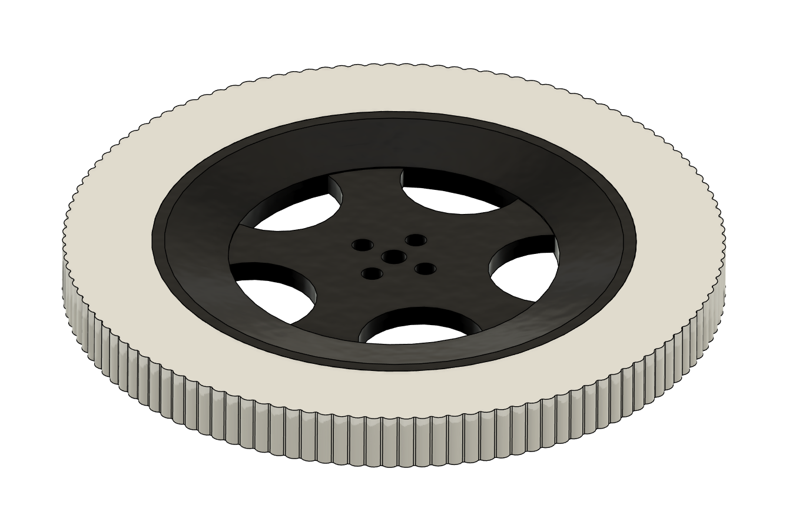
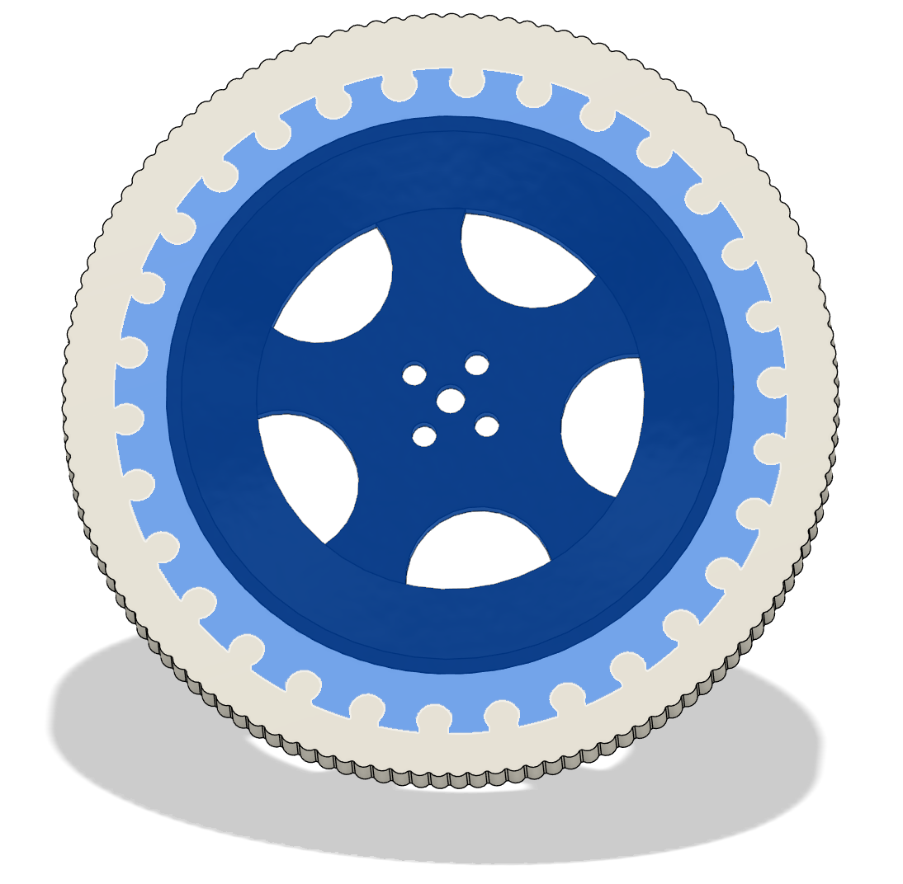

Most importantly was playing around with materials, infill and printing patterns. Rectangular patterns create an orthotropic or non-isotropic elasticity - meaning one direction is fairly flexible while another direction feels stiff. We currently use a `Archimedes Chords` pattern for the outer walls and a `Gyroid` infill pattern.

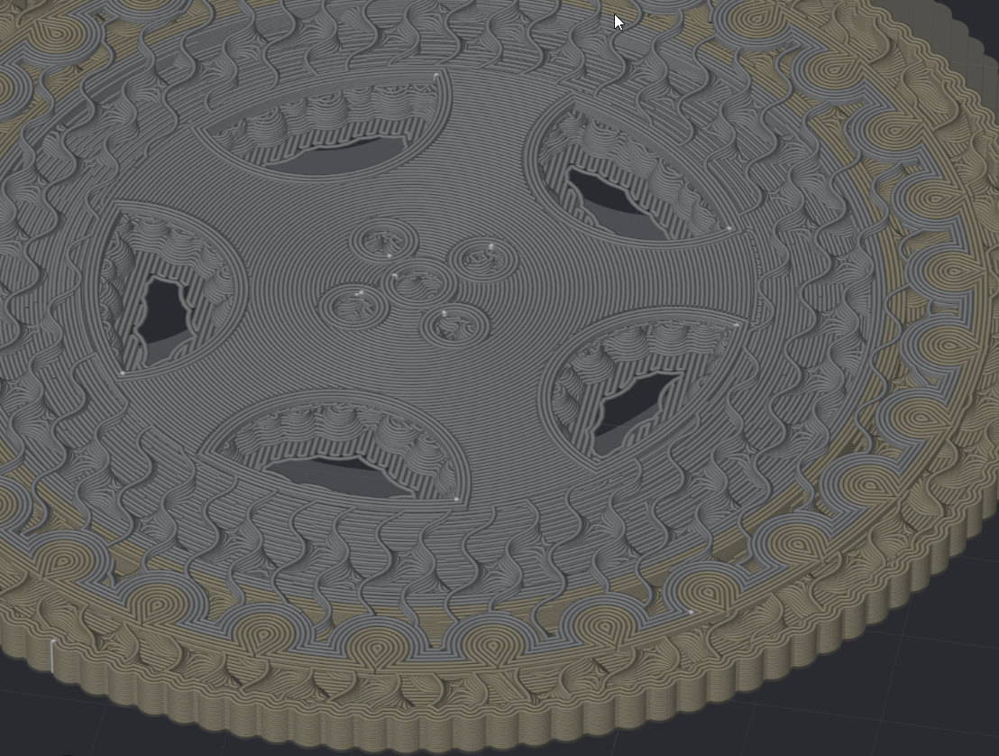
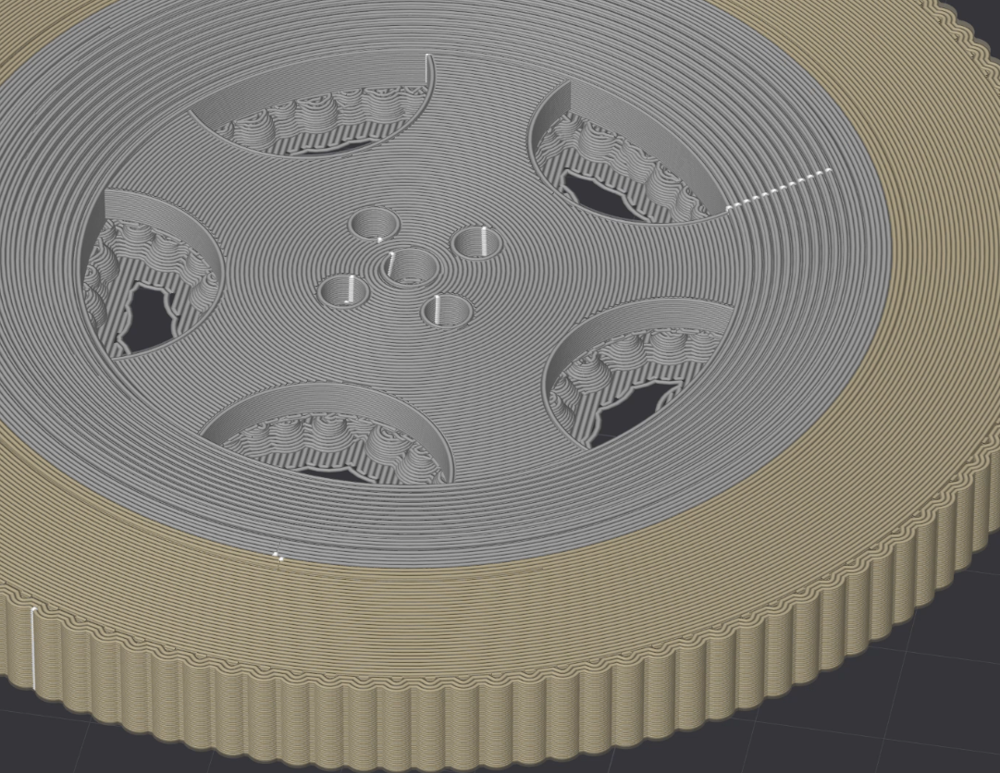

Soft TPU means Shore A hardness below 60 and that is tricky to print - though, it is possible with a good printer and an appropriate filament setup. For our validation we used a `Bambulab H2D` printer with TPU 90 (far to stiff) and `Recreus Filaflex™ Foamy` which should go down to a Shore A hardness of 51.

You can by such a filament for instance here (yes, it is quiet expensive):

[Recreus Filaflex Foamy TPU filament](https://filamentworld.de/shop/special-filament/filaflex-filament/recreus-filaflex-foamy-tpu-filament-bis-51a-natur-1-75-mm/?switch_shop=b2c)

I am quiet happy with the current result, but I have to point out that surface friction is still not ideal.

## Web interface

The web interface was already very powerfull - almost too powerfull for the basic user. So I did not add anything substantial. In combination with the basic functions of the touch TFT the web interface is to my mind just perfect. I did only minor adaptions by adding the definition of a maximum and minimum servo angle for rotation of the chute tower on the setup page and by introducing custom shot patterns. The last choosen pattern can then be accessed directly by the according button on the touch TFT. I started reworking the web user interface (UI) with focus on better visualization for different aspect ratios also taking care for multi-column suport in landscape mode, e.g. with a tablet.

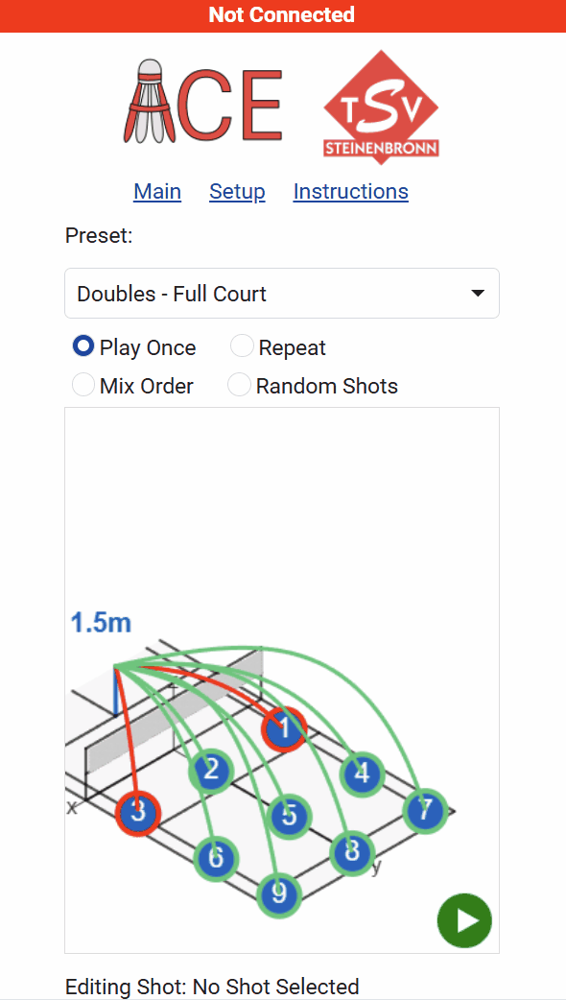

## Localization aka language support

I implemented a language support so in future more languages can be added to the user interface allowing a more comfortable utilization for users in their native language.

## Manual control

Added a manual control page which allows kind of a trainer mode, defining trajectory inclination and rotation by a touch joystick. Tapping the Shoot button ones makes a single shot while tapping it twice within one seconds start continuous shooting mode (fun). Throttle speed can be controlled via a slider as well as motor bias meaning the left to right balance.

## Wireless remote control

Peter wrote me that he was thinking about adding some kind of `remote control` (e.g. with RF remote control switch).
[RF remote control switch](https://www.amazon.de/Gebildet-Universal-Fernbedienungsschalter-Relais-Empfängermodul-Momentan-Kippriegel-1Empfänger/dp/B0DJX32J75)

As the ESP32 already support Bluetooth out-of-the-box I added that feature and ordered some Bluetooth remote buttons for making selfie shots. The sake of it is that due to the large size of the overall firmware image (approx. 1.8 MB) a redifinition of the partition image without the OTA section was needed. But I do not need OTA too much. Currently untested...

[Bluetooth camera remote shutter](https://www.amazon.de/AMATHINGS-Kamera-Auslöser-Fernbedienung-Bluetooth-Technologie-Fernauslöser/dp/B07ZG291YX)

## Bluetooth remote controls

The setup page pairs a BLE HID remote over Bluetooth Low Energy (NimBLE stack, no Bluetooth Classic/Bluedroid). It scans for the HID over GATT service (0x1812), connects as a GATT client and subscribes to the HID input reports. The paired peer is stored and reconnects automatically after a restart. On the `AB Shutter3`, a button press on the remote toggles launcher start and stop; while the manual page is open, the remote button works like the SHOOT button (tap to shoot once, double-tap for continuous shooting).

The firmware uses a single 2 MB application partition and a 1.875 MB SPIFFS partition. This layout has no OTA update slot. After changing from the previous partition layout, flash both the firmware and filesystem over USB:

```text
pio run -e nodemcu-32s -t upload
pio run -e nodemcu-32s -t uploadfs
```

## Shopping list

I personally do not like Amazon too much, but unfortunately it gives us a great opportunity to get the same product almost everywhere in the world. Therefore, - as Peter already did - I mainly used Amazon links to share the enhanced shopping list. Please take care that maybe not everything is needed for your setup - so please review carefully before blindly putting stuff to your shopping cart. And also some components may be missing, e.g. cable ties, or a threaded nut with for the tripod mount with a wrench size of 13 mm or some of the self-tapping screws. With the servos there come besides the different servor horns screws as well - so you can use those easily without additional costs.

One thing which might not be obvious: the power supply is fully realized by the two electronic speed controllers utilizing their capability of what they call a Battery Eliminator Circuit `BEC` - delivering each 3 A at 5 V. I splitted the circuits of both ESCs on the PCB to avoid interferences of the BEC circuits, so one is responsible for the ESP32 microprocessor and through beam sensor power supply while the other cares for all servos.

## First assembly

Before the first assembly:

* Electrically connect the servos but `not the ESCs, not the LEDs and not the battery`.
* Double check polarity everywhere (taking care not to produce shortcuts!),
* please do not connect the battery, but connect your USB flashing cable to the ESP32,
* flash the ESP32 and the file system image (maybe with your clubs own logo),
* connect to the boards WLAN (e.g. ACE_1)
* open to the ACE web page (e.g. [Ace.local](https://Ace.local) or 192.168.4.1) --> maybe you need to turn of mobile data to successfully call the web page as per default traffic is directed to the connection with an internet connection.
* go to setup page and move all servos to setup position! This aligns the horns correctly in their assembly position.
* Before you now start the mechanical assembly, we need to calibrate the ESCs (ATTENTION: The motors should not start turning if everything is correct, but please be aware that they could. Keep clear of the motors and ensure they can spin freely in case calibration or speed control fails). Whith the setup page of the web interface open follow the detailed instructions on the ESC calibration (set to `Max. Throttle`, then connect an ESC to the battery and then set to `Min. Throttle` to finish calibration)
* If ESC calibration is done, disconnect the system from all power supplies and start the mechanical assembly. Regarding horn positions and correct horn types please consult the images provided. I will try to add detailed images of every servo horn and linkage for easier assembly.
* With the servos are in place, connect to WLAN and open the setup page to set up the limits of each servo. This is a step which is suited to your individual setup, but below some default values are given as an orientation.

IMPORTANT: Please be aware that for the gripper servo it is beneficial if it just closes far enough to prevent the next shuttle to drop. If closing too much you will potentially squeeze and damage your shuttles - here the less is more! Do not forget to save your settings after adjsustment.

* Gripper open position: 30°
* Gripper close position: 55° (keep in mind if there are many shuttles in the tube they still should be securely held back as well)
* Pusher catch position: 100°
* Pusher push position: 60°
* Left rotation position: 160°
* Right rotation position: 20°
* Maximum trajectory inclination: 60°
* Minimum trajectory inclination: 180°

## Servo horn assembly

* Gripper servo

  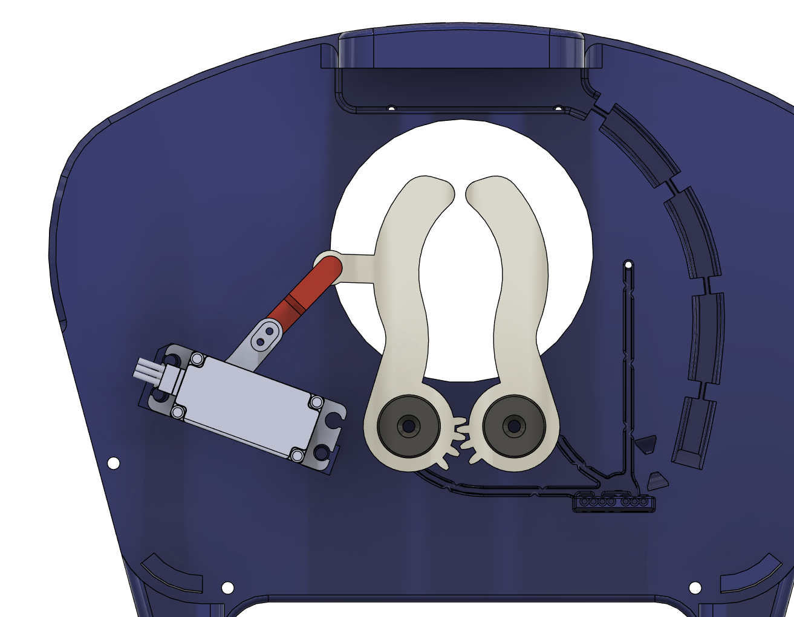

* Pusher servo

  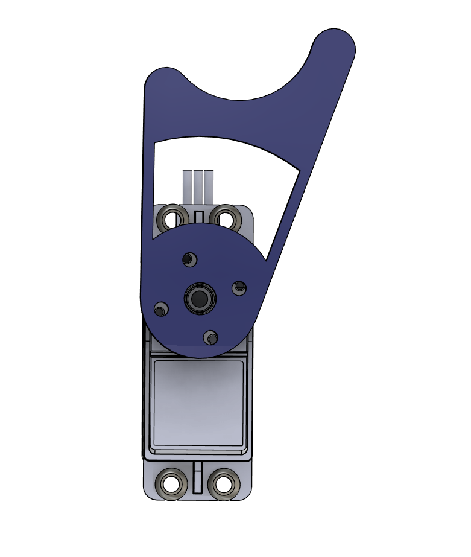

* Trajectory servo

  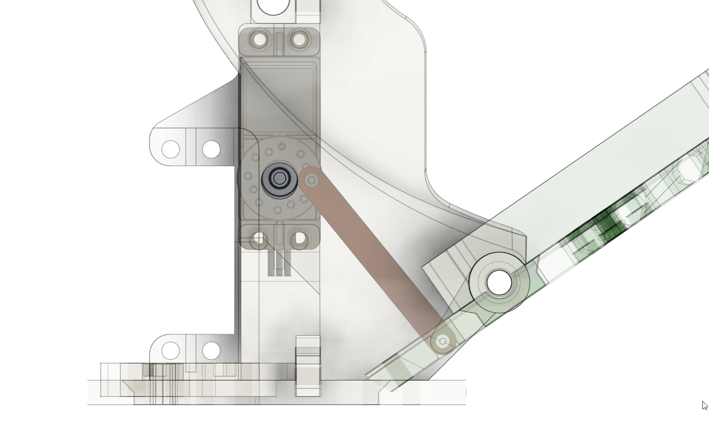

* Rotation servo

  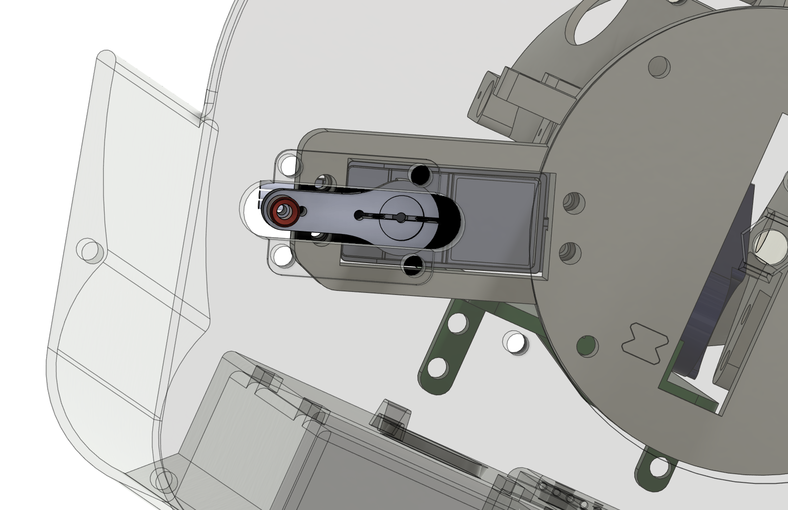

* Gripper servo (grip+pull concept)

  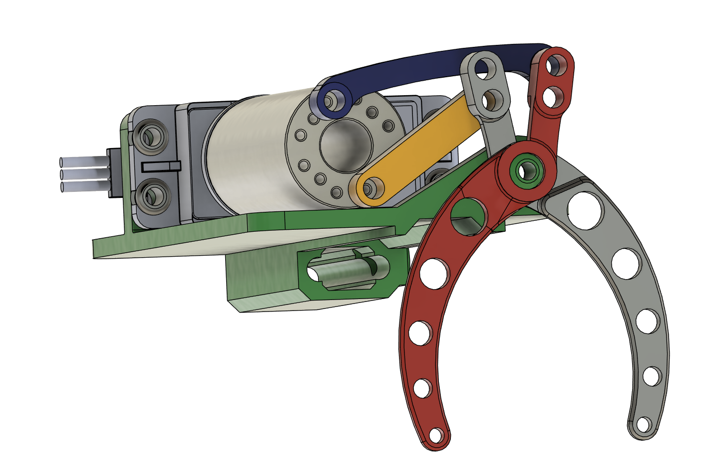

* Carriage servo (grip+pull concept)

  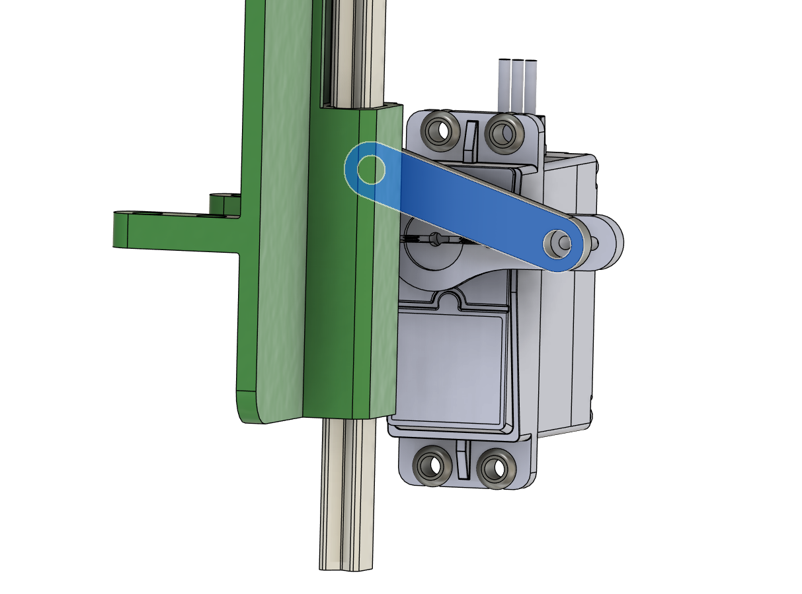
  